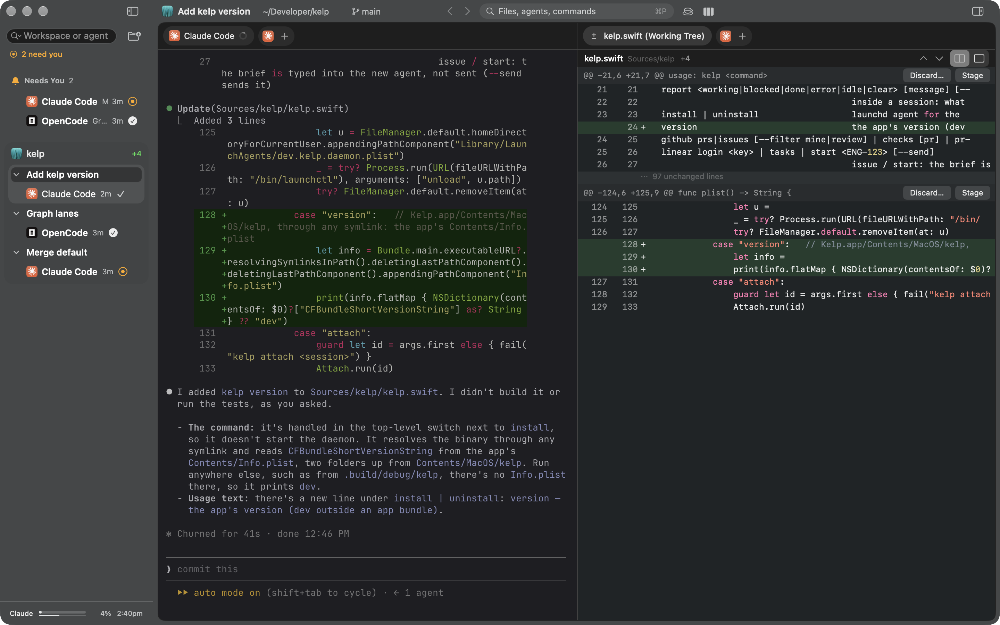
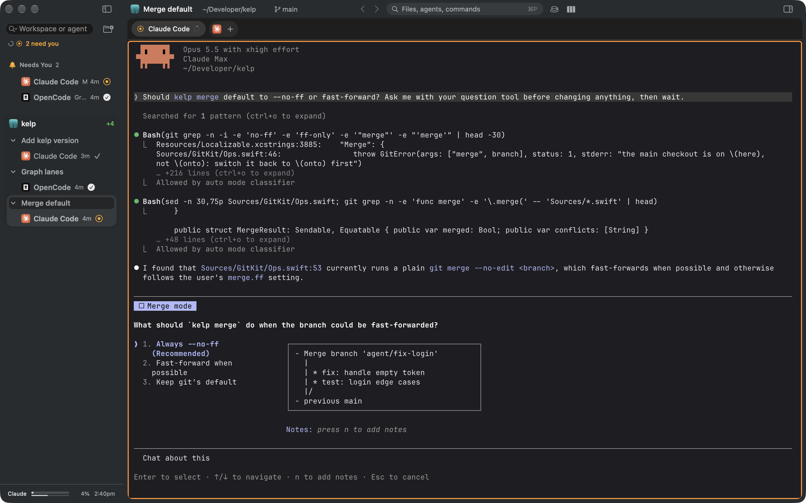

# Kelp

A native macOS IDE between a classic editor like VS Code and an agent app like Claude Desktop: agents work side by
side, and the code they touch is one tab away to read, review and edit.



- **Code at hand.** Editor with language servers, file tree, diffs, browser; any tab in any split.
- **Agents first.** Any CLI agent, live status, review as a diff; agents keep working after you quit the app.
- **Extensible.** Panels, commands and themes come from extensions; a JSON file is enough.
- **Native.** Swift + AppKit, terminal on libghostty. No Electron, no cloud, no telemetry.



Requires macOS 14+.

## Install

Download `Kelp.dmg` from [Releases](https://github.com/nikiomori/kelp/releases/latest) and drag Kelp to Applications;
it updates itself (Kelp › Check for Updates…). Kelp's terminals have `kelp` on their PATH; for other terminals:
`ln -s /Applications/Kelp.app/Contents/MacOS/kelp /usr/local/bin/kelp`.

## Build and run

```sh
scripts/build-ghostty.sh         # once: libghostty into Vendor/ (downloads zig 0.16 into a cache)
swift build                      # everything
swift test                       # all tests
scripts/bundle.sh                # dist/Kelp.app + dist/Kelp.dmg (universal, release)
SIGN_ID="Developer ID Application: …" NOTARY_PROFILE=kelp scripts/bundle.sh   # signed + notarized
scripts/publish.sh               # GitHub release + update feed for that DMG (bump the version in Resources/Info.plist first)
```

For quick iteration: `swift build && .build/debug/KelpApp` (the app starts `kelpd` next to it if needed).

## CLI

```sh
kelp status
kelp session new --agent claude                                # in the workspace of the current folder
kelp worktree create feat/login | list | current | note "half done"
kelp terminal list | read <id> | send <id> "run the tests" | context <id>
kelp diff | commit "msg" | merge | push
kelp install                                                   # run the daemon as a LaunchAgent
```

## Per-repo config: `.kelp.yaml`

```yaml
setup: npm install              # runs in every new worktree
shared: node_modules            # symlinked from the main checkout instead of reinstalling
tabs: claude, shell             # sessions opened in each new worktree
issueCommand: "Fix {title}: {body}"
recipe.commit: "Write a conventional commit for: {stagedPatch}"
```

`.worktreeinclude` lists gitignored files (globs) copied into new worktrees, e.g. `.env*`.

## Architecture

See [docs/architecture.md](docs/architecture.md). License: MIT.
